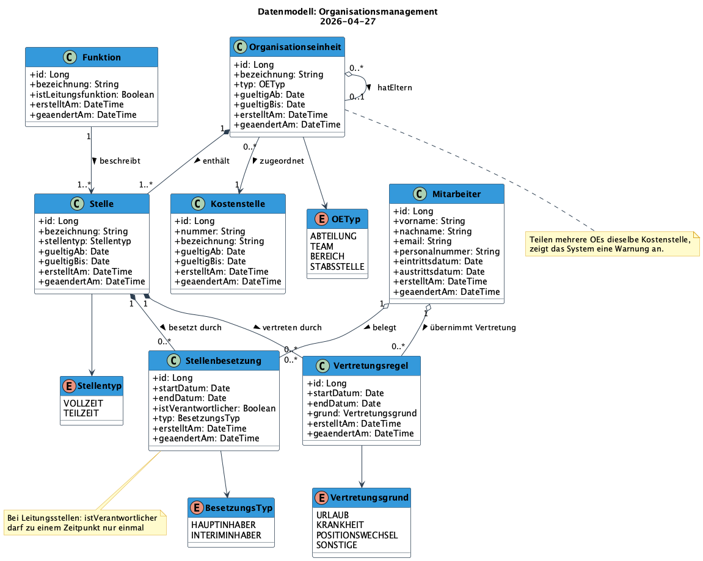

# Datenstruktur-Spezifikation: Organisationsmanagement

**Erstellt am**: 2026-04-27
**Basiert auf Demand**: [Demand-Organisationsmanagement-2026-04-27.md](../demands/Demand-Organisationsmanagement-2026-04-27.md)
**Basiert auf Requirements**: [Requirements-Organisationsmanagement-2026-04-27.md](Requirements-Organisationsmanagement-2026-04-27.md)
**Status**: In Bearbeitung

---

## 1. Kontext

### Systembeschreibung
Führendes Organisationsmanagement-System (Single Source of Truth) zur Verwaltung von Mitarbeitern, Organisationseinheiten, Stellen, Funktionen, Kostenstellen und Vertretungsregelungen. Das System stellt anderen Systemen eine API-Schnittstelle bereit.

### Scope des Datenmodells
Im Modell enthalten: Organisationsstruktur, Stellenbesetzungen, Vertretungsregelungen, Kostenstellen-Zuordnung.
Bewusst ausgelassen: Urlaubsgenehmigung, Gehaltsabrechnung, technische API-Modelle.

---

## 2. Entitäten (Übersicht)

| Entität | Beschreibung | Schlüsselattribute |
|---|---|---|
| Mitarbeiter | Person im Unternehmen | id, personalnummer, email |
| Organisationseinheit | Hierarchische Struktureinheit (Abteilung, Team...) | id, bezeichnung, typ |
| Funktion | Fachliche Rolle/Bezeichnung; steuert Leitungslogik | id, bezeichnung, istLeitungsfunktion |
| Stelle | Konkrete Position in einer OE mit zugeordneter Funktion | id, bezeichnung, stellentyp |
| Kostenstelle | Kostenzuordnungseinheit; kann mehreren OEs zugeordnet sein | id, nummer, bezeichnung |
| Stellenbesetzung | Zeitgebundene Zuordnung eines Mitarbeiters zu einer Stelle | id, startDatum, endDatum, istVerantwortlicher |
| Vertretungsregel | Zeitgebundene Vertretung eines Mitarbeiters für eine Stelle | id, startDatum, endDatum, grund |

---

## 3. Detailbeschreibung der Entitäten

### Mitarbeiter

**Beschreibung**: Repräsentiert eine Person im Unternehmen mit ihren Stammdaten.

**Attribute**:

| Attribut | Typ | Pflicht | Beschreibung |
|---|---|---|---|
| id | Long | Ja | Technischer Primärschlüssel |
| vorname | String | Ja | Vorname der Person |
| nachname | String | Ja | Nachname der Person |
| email | String | Ja | E-Mail-Adresse |
| personalnummer | String | Ja | Eindeutige Personalnummer |
| eintrittsdatum | Date | Ja | Datum des Firmeneintritts |
| austrittsdatum | Date | Nein | Datum des Firmenaustritts (leer = aktiv) |
| erstelltAm | DateTime | Ja | Erstellungszeitpunkt |
| geaendertAm | DateTime | Ja | Letzter Änderungszeitpunkt |

**Beziehungen**:
- Hat `0..*` Stellenbesetzungen (Aggregation)
- Hat `0..*` Vertretungsregeln als Vertretungsperson (Aggregation)

---

### Organisationseinheit

**Beschreibung**: Struktureinheit der Organisation (Abteilung, Team, Bereich, Stabsstelle). Hierarchisch aufgebaut durch Eltern-Kind-Beziehung.

**Attribute**:

| Attribut | Typ | Pflicht | Beschreibung |
|---|---|---|---|
| id | Long | Ja | Technischer Primärschlüssel |
| bezeichnung | String | Ja | Name der Einheit (z.B. „Vertrieb Nord") |
| typ | OETyp | Ja | Art der Einheit (ABTEILUNG, TEAM, BEREICH, STABSSTELLE) |
| gueltigAb | Date | Ja | Gültig ab Datum |
| gueltigBis | Date | Nein | Gültig bis Datum (leer = aktiv) |
| erstelltAm | DateTime | Ja | Erstellungszeitpunkt |
| geaendertAm | DateTime | Ja | Letzter Änderungszeitpunkt |

**Beziehungen**:
- Gehört zu `0..1` übergeordneter Organisationseinheit (Aggregation, `hatEltern`)
- Hat `0..*` untergeordnete Organisationseinheiten
- Ist zugeordnet zu `1` Kostenstelle (Assoziation) — Warnung bei Überschneidung
- Enthält `1..*` Stellen (Komposition)

---

### Funktion

**Beschreibung**: Fachliche Rolle oder Bezeichnung (z.B. „Abteilungsleiter", „Controller"). Steuert über `istLeitungsfunktion`, ob eine Stelle besondere Verantwortlichkeits-Logik erfordert.

**Attribute**:

| Attribut | Typ | Pflicht | Beschreibung |
|---|---|---|---|
| id | Long | Ja | Technischer Primärschlüssel |
| bezeichnung | String | Ja | Funktionsbezeichnung (z.B. „Teamleiter") |
| istLeitungsfunktion | Boolean | Ja | Steuert: Muss zu jeder Zeit ein Verantwortlicher zugeordnet sein? |
| erstelltAm | DateTime | Ja | Erstellungszeitpunkt |
| geaendertAm | DateTime | Ja | Letzter Änderungszeitpunkt |

**Beziehungen**:
- Beschreibt `1..*` Stellen (Assoziation)

---

### Stelle

**Beschreibung**: Konkrete Position innerhalb einer Organisationseinheit. Referenziert eine Funktion und kann durch Mitarbeiter besetzt sowie durch Vertretungsregeln abgedeckt werden.

**Attribute**:

| Attribut | Typ | Pflicht | Beschreibung |
|---|---|---|---|
| id | Long | Ja | Technischer Primärschlüssel |
| bezeichnung | String | Ja | Stellenbezeichnung (z.B. „Abteilungsleiter Vertrieb Nord") |
| stellentyp | Stellentyp | Ja | VOLLZEIT oder TEILZEIT |
| gueltigAb | Date | Ja | Gültig ab Datum |
| gueltigBis | Date | Nein | Gültig bis Datum (leer = aktiv) |
| erstelltAm | DateTime | Ja | Erstellungszeitpunkt |
| geaendertAm | DateTime | Ja | Letzter Änderungszeitpunkt |

**Beziehungen**:
- Referenziert `1` Funktion (Assoziation)
- Gehört zu `1` Organisationseinheit (Komposition)
- Hat `0..*` Stellenbesetzungen (Komposition)
- Hat `0..*` Vertretungsregeln (Komposition)

---

### Kostenstelle

**Beschreibung**: Kostenzuordnungseinheit. Kann mehreren Organisationseinheiten zugeordnet sein — das System zeigt in diesem Fall eine Warnung an.

**Attribute**:

| Attribut | Typ | Pflicht | Beschreibung |
|---|---|---|---|
| id | Long | Ja | Technischer Primärschlüssel |
| nummer | String | Ja | Eindeutige Kostenstellen-Nummer (z.B. „4711") |
| bezeichnung | String | Ja | Bezeichnung der Kostenstelle |
| gueltigAb | Date | Ja | Gültig ab Datum |
| gueltigBis | Date | Nein | Gültig bis Datum (leer = aktiv) |
| erstelltAm | DateTime | Ja | Erstellungszeitpunkt |
| geaendertAm | DateTime | Ja | Letzter Änderungszeitpunkt |

**Beziehungen**:
- Wird von `0..*` Organisationseinheiten referenziert (Assoziation)

---

### Stellenbesetzung

**Beschreibung**: Zeitgebundene Zuordnung eines Mitarbeiters zu einer Stelle. Bei Leitungsstellen muss `istVerantwortlicher` zu jedem Zeitpunkt für genau eine aktive Besetzung `true` sein.

**Attribute**:

| Attribut | Typ | Pflicht | Beschreibung |
|---|---|---|---|
| id | Long | Ja | Technischer Primärschlüssel |
| startDatum | Date | Ja | Beginn der Besetzung |
| endDatum | Date | Nein | Ende der Besetzung (leer = aktuell aktiv) |
| istVerantwortlicher | Boolean | Ja | Kennzeichnet den Verantwortlichen bei Leitungsstellen |
| typ | BesetzungsTyp | Ja | HAUPTINHABER oder INTERIMINHABER |
| erstelltAm | DateTime | Ja | Erstellungszeitpunkt |
| geaendertAm | DateTime | Ja | Letzter Änderungszeitpunkt |

**Beziehungen**:
- Gehört zu `1` Stelle (Komposition)
- Gehört zu `1` Mitarbeiter (Aggregation)

**Validierungsregel**: Bei einer Stelle mit `istLeitungsfunktion = true` darf zu jedem Zeitpunkt nur eine Stellenbesetzung `istVerantwortlicher = true` haben.

---

### Vertretungsregel

**Beschreibung**: Zeitgebundene Regelung, durch die ein Mitarbeiter eine Stelle für einen definierten Zeitraum vertritt. Wird automatisch aktiviert und deaktiviert.

**Attribute**:

| Attribut | Typ | Pflicht | Beschreibung |
|---|---|---|---|
| id | Long | Ja | Technischer Primärschlüssel |
| startDatum | Date | Ja | Beginn der Vertretung |
| endDatum | Date | Ja | Ende der Vertretung (immer angegeben) |
| grund | Vertretungsgrund | Ja | URLAUB, KRANKHEIT, POSITIONSWECHSEL, SONSTIGE |
| erstelltAm | DateTime | Ja | Erstellungszeitpunkt |
| geaendertAm | DateTime | Ja | Letzter Änderungszeitpunkt |

**Beziehungen**:
- Gehört zu `1` Stelle (Komposition)
- Gehört zu `1` Mitarbeiter als Vertretungsperson (Aggregation)

---

## 4. Beziehungsübersicht

| Von | Beziehung | Zu | Typ | Multiplizität |
|---|---|---|---|---|
| Organisationseinheit | hatEltern | Organisationseinheit | Aggregation | 0..* zu 0..1 |
| Organisationseinheit | zugeordnet | Kostenstelle | Assoziation | 0..* zu 1 |
| Organisationseinheit | enthält | Stelle | Komposition | 1 zu 1..* |
| Funktion | beschreibt | Stelle | Assoziation | 1 zu 1..* |
| Stelle | besetzt durch | Stellenbesetzung | Komposition | 1 zu 0..* |
| Mitarbeiter | belegt | Stellenbesetzung | Aggregation | 1 zu 0..* |
| Stelle | vertreten durch | Vertretungsregel | Komposition | 1 zu 0..* |
| Mitarbeiter | übernimmt Vertretung | Vertretungsregel | Aggregation | 1 zu 0..* |

---

## 5. Enumerationen

### OEStatus
| Wert | Beschreibung |
|---|---|
| ENTWURF | Angelegt, noch nicht freigegeben |
| AKTIV | Freigegeben und wirksam |
| INAKTIV | Vorübergehend deaktiviert |
| AUFGELOEST | Dauerhaft aufgelöst (irreversibel) |

### OETyp
| Wert | Beschreibung |
|---|---|
| ABTEILUNG | Klassische Abteilung |
| TEAM | Untergeordnetes Team innerhalb einer Abteilung |
| BEREICH | Übergeordneter Unternehmensbereich |
| STABSSTELLE | Stabsstelle ohne Linienverantwortung |

### StelleStatus
| Wert | Beschreibung |
|---|---|
| ENTWURF | Angelegt, noch nicht freigegeben |
| AKTIV | Freigegeben und wirksam; kann besetzt werden |
| INAKTIV | Vorübergehend deaktiviert |
| AUFGELOEST | Dauerhaft aufgelöst (irreversibel) |

### Stellentyp
| Wert | Beschreibung |
|---|---|
| VOLLZEIT | Vollzeitstelle |
| TEILZEIT | Teilzeitstelle |

### StellenbesetzungStatus
| Wert | Beschreibung |
|---|---|
| GEPLANT | Angelegt, startDatum liegt in der Zukunft |
| AKTIV | startDatum erreicht, Besetzung ist wirksam |
| BEENDET | endDatum erreicht oder manuell beendet (irreversibel) |
| STORNIERT | Vor Aktivierung abgebrochen (irreversibel) |

### BesetzungsTyp
| Wert | Beschreibung |
|---|---|
| HAUPTINHABER | Reguläre Stellenbesetzung |
| INTERIMINHABER | Übergangsweise Besetzung (z.B. bei Positionswechsel) |

### VertretungsregelStatus
| Wert | Beschreibung |
|---|---|
| GEPLANT | Angelegt, startDatum liegt in der Zukunft |
| AKTIV | startDatum erreicht, Vertretung ist wirksam |
| BEENDET | endDatum erreicht oder vorzeitig beendet (irreversibel) |
| STORNIERT | Vor Aktivierung abgebrochen (irreversibel) |

### Vertretungsgrund
| Wert | Beschreibung |
|---|---|
| URLAUB | Geplante Abwesenheit durch Urlaub |
| KRANKHEIT | Ungeplante Abwesenheit durch Krankheit |
| POSITIONSWECHSEL | Übergangsvertretung bei geplantem Stellenwechsel |
| SONSTIGE | Sonstiger Grund |

---

## 6. Datenmodell-Diagramm

*PlantUML-Quelldatei: [Data-Structure-Organisationsmanagement-2026-04-27.puml](Data-Structure-Organisationsmanagement-2026-04-27.puml)*

---

## 7. Designentscheidungen & Anmerkungen

- **Kostenstellen-Überschneidung**: Mehrere OEs können dieselbe Kostenstelle referenzieren. Das System erlaubt dies, zeigt aber eine Warnung an. Eine 1:1-Erzwingung wäre zu restriktiv für die fachliche Realität.
- **Mehrfachbesetzung einer Stelle**: Eine Stelle kann gleichzeitig von mehreren Mitarbeitern besetzt sein (z.B. Teilzeit). Bei Leitungsstellen muss jedoch genau ein Inhaber als `istVerantwortlicher = true` markiert sein.
- **Vertretungsregel vs. Stellenbesetzung**: Vertretungsregeln sind bewusst von Stellenbesetzungen getrennt, da sie einen anderen fachlichen Zweck haben (temporäre Abdeckung vs. reguläre Besetzung) und immer ein definiertes Enddatum haben.
- **Funktion als Stammdatum**: Funktionen sind eigenständige Stammdaten, die mehreren Stellen zugeordnet werden können. Dies verhindert Redundanz bei gleichen Funktionsbezeichnungen in verschiedenen OEs.

---

## 8. Nächste Schritte

Diese Datenstruktur-Spezifikation ist bereit für:
1. Review durch Stakeholder und Entwicklungsteam
2. Weiterführung mit `requirements-engineer-entity-states` (Zustandsmodellierung)
3. Abgleich mit der technischen Architektur
4. Ableitung des physischen Datenbankschemas

---

*Dokumentiert mit dem requirements-engineer-data-structure Agent am 2026-04-27*
