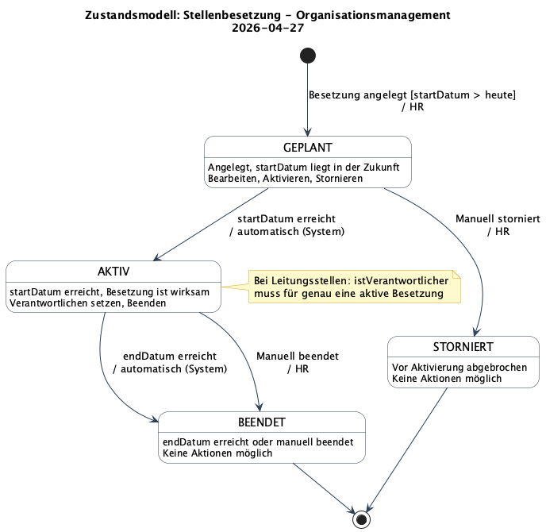
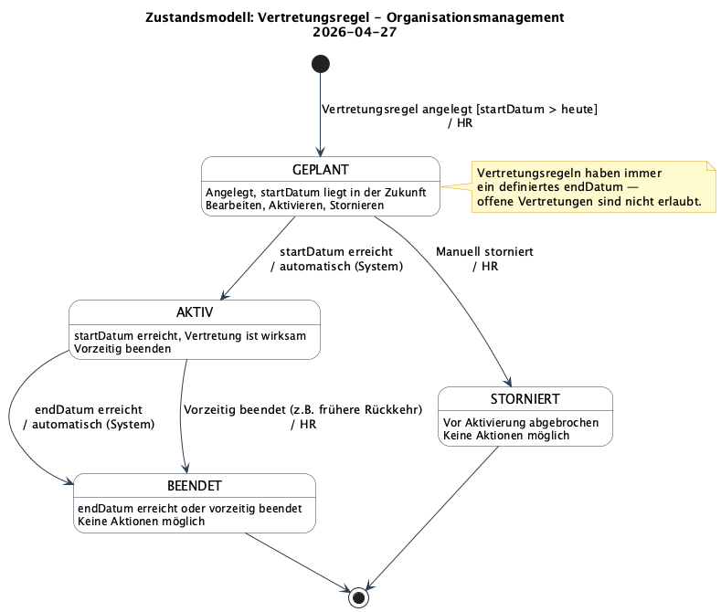
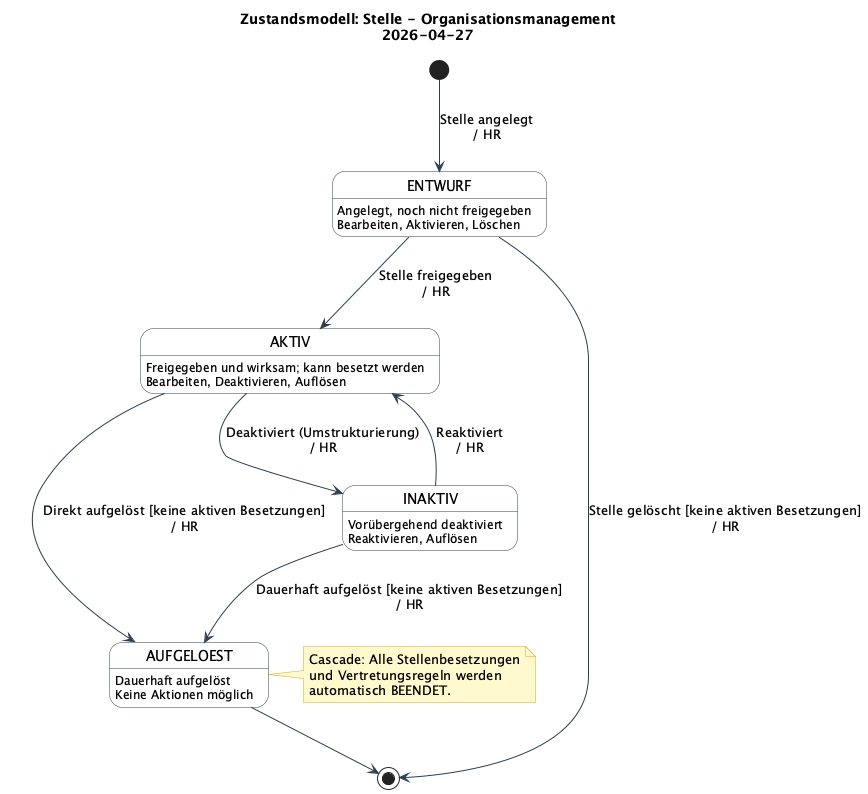
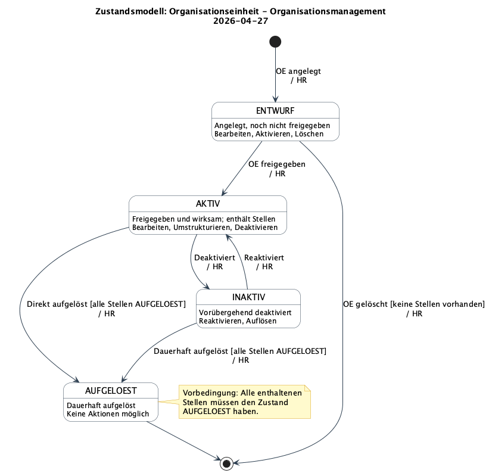

# Zustandsmodell-Spezifikation: Organisationsmanagement

**Erstellt am**: 2026-04-27
**Basiert auf Demand**: [Demand-Organisationsmanagement-2026-04-27.md](../demands/Demand-Organisationsmanagement-2026-04-27.md)
**Basiert auf Datenstruktur**: [Data-Structure-Organisationsmanagement-2026-04-27.md](Data-Structure-Organisationsmanagement-2026-04-27.md)
**Status**: In Bearbeitung

---

## 1. Kontext

### Systembeschreibung
Führendes Organisationsmanagement-System zur Verwaltung von Mitarbeitern, Stellen, Organisationseinheiten, Kostenstellen und Vertretungsregelungen. Kernforderung: zu jedem Zeitpunkt ist je Leitungsfunktion genau eine verantwortliche Person ermittelbar.

### Scope der Zustandsmodellierung
Modelliert: Stellenbesetzung, Vertretungsregel, Stelle, Organisationseinheit.
Nicht modelliert: Mitarbeiter, Funktion, Kostenstelle — diese haben keinen fachlich relevanten Lifecycle im Systemkontext.

---

## 2. Übersicht modellierter Entitäten

| Entität | Status-Attribut (neu) | Anzahl Zustände | Bemerkung |
|---|---|---|---|
| Stellenbesetzung | status: StellenbesetzungStatus | 4 | Automatische Aktivierung durch System |
| Vertretungsregel | status: VertretungsregelStatus | 4 | Automatische Aktivierung/Deaktivierung durch System |
| Stelle | status: StelleStatus | 4 | Cascade bei AUFGELOEST |
| Organisationseinheit | status: OEStatus | 4 | Cascade-Vorbedingung: alle Stellen AUFGELOEST |

---

## 3. Zustandsmodell: Stellenbesetzung

### Zustandsbeschreibungen

| Zustand | Beschreibung | Erlaubte Aktionen |
|---|---|---|
| **GEPLANT** | Angelegt, startDatum liegt in der Zukunft | Bearbeiten, Aktivieren, Stornieren |
| **AKTIV** | startDatum erreicht, Besetzung ist wirksam | Verantwortlichen setzen, Beenden |
| **BEENDET** | endDatum erreicht oder manuell beendet | Keine (irreversibel) |
| **STORNIERT** | Vor Aktivierung abgebrochen | Keine (irreversibel) |

### Zustandsübergänge

| Von | Nach | Ereignis/Bedingung | Aktion | Berechtigung |
|---|---|---|---|---|
| `[*]` | GEPLANT | Besetzung angelegt; startDatum > heute | — | HR |
| GEPLANT | AKTIV | startDatum erreicht | automatisch (System) | — |
| GEPLANT | STORNIERT | Manuell storniert | — | HR |
| AKTIV | BEENDET | endDatum erreicht | automatisch (System) | — |
| AKTIV | BEENDET | Manuell beendet | — | HR |
| BEENDET | `[*]` | Terminal | — | — |
| STORNIERT | `[*]` | Terminal | — | — |

**Validierungsregel:** Bei Leitungsstellen muss `istVerantwortlicher = true` für genau eine aktive Stellenbesetzung gelten.

### Diagramm

*PlantUML-Quelldatei: [Entity-States-Stellenbesetzung-Organisationsmanagement-2026-04-27.puml](Entity-States-Stellenbesetzung-Organisationsmanagement-2026-04-27.puml)*

---

## 4. Zustandsmodell: Vertretungsregel

### Zustandsbeschreibungen

| Zustand | Beschreibung | Erlaubte Aktionen |
|---|---|---|
| **GEPLANT** | Angelegt, startDatum liegt in der Zukunft | Bearbeiten, Aktivieren, Stornieren |
| **AKTIV** | startDatum erreicht, Vertretung ist wirksam | Vorzeitig beenden |
| **BEENDET** | endDatum erreicht oder vorzeitig beendet | Keine (irreversibel) |
| **STORNIERT** | Vor Aktivierung abgebrochen | Keine (irreversibel) |

### Zustandsübergänge

| Von | Nach | Ereignis/Bedingung | Aktion | Berechtigung |
|---|---|---|---|---|
| `[*]` | GEPLANT | Vertretungsregel angelegt; startDatum > heute | — | HR |
| GEPLANT | AKTIV | startDatum erreicht | automatisch (System) | — |
| GEPLANT | STORNIERT | Manuell storniert | — | HR |
| AKTIV | BEENDET | endDatum erreicht | automatisch (System) | — |
| AKTIV | BEENDET | Vorzeitig beendet (z.B. frühere Rückkehr) | — | HR |
| BEENDET | `[*]` | Terminal | — | — |
| STORNIERT | `[*]` | Terminal | — | — |

**Hinweis:** Vertretungsregeln haben immer ein definiertes endDatum — offene Vertretungen sind nicht erlaubt.

### Diagramm

*PlantUML-Quelldatei: [Entity-States-Vertretungsregel-Organisationsmanagement-2026-04-27.puml](Entity-States-Vertretungsregel-Organisationsmanagement-2026-04-27.puml)*

---

## 5. Zustandsmodell: Stelle

### Zustandsbeschreibungen

| Zustand | Beschreibung | Erlaubte Aktionen |
|---|---|---|
| **ENTWURF** | Angelegt, noch nicht freigegeben | Bearbeiten, Aktivieren, Löschen |
| **AKTIV** | Freigegeben und wirksam; kann besetzt werden | Bearbeiten, Deaktivieren, Auflösen |
| **INAKTIV** | Vorübergehend deaktiviert | Reaktivieren, Auflösen |
| **AUFGELOEST** | Dauerhaft aufgelöst | Keine (irreversibel) |

### Zustandsübergänge

| Von | Nach | Ereignis/Bedingung | Aktion | Berechtigung |
|---|---|---|---|---|
| `[*]` | ENTWURF | Stelle angelegt | — | HR |
| ENTWURF | AKTIV | Stelle freigegeben | — | HR |
| ENTWURF | `[*]` | Stelle gelöscht [keine aktiven Besetzungen] | — | HR |
| AKTIV | INAKTIV | Deaktiviert (Umstrukturierung) | — | HR |
| AKTIV | AUFGELOEST | Direkt aufgelöst [keine aktiven Besetzungen] | Cascade: Besetzungen → BEENDET | HR |
| INAKTIV | AKTIV | Reaktiviert | — | HR |
| INAKTIV | AUFGELOEST | Dauerhaft aufgelöst [keine aktiven Besetzungen] | Cascade: Besetzungen → BEENDET | HR |
| AUFGELOEST | `[*]` | Terminal | — | — |

### Diagramm

*PlantUML-Quelldatei: [Entity-States-Stelle-Organisationsmanagement-2026-04-27.puml](Entity-States-Stelle-Organisationsmanagement-2026-04-27.puml)*

---

## 6. Zustandsmodell: Organisationseinheit

### Zustandsbeschreibungen

| Zustand | Beschreibung | Erlaubte Aktionen |
|---|---|---|
| **ENTWURF** | Angelegt, noch nicht freigegeben | Bearbeiten, Aktivieren, Löschen |
| **AKTIV** | Freigegeben und wirksam; enthält Stellen | Bearbeiten, Umstrukturieren, Deaktivieren |
| **INAKTIV** | Vorübergehend deaktiviert | Reaktivieren, Auflösen |
| **AUFGELOEST** | Dauerhaft aufgelöst | Keine (irreversibel) |

### Zustandsübergänge

| Von | Nach | Ereignis/Bedingung | Aktion | Berechtigung |
|---|---|---|---|---|
| `[*]` | ENTWURF | OE angelegt | — | HR |
| ENTWURF | AKTIV | OE freigegeben | — | HR |
| ENTWURF | `[*]` | OE gelöscht [keine Stellen vorhanden] | — | HR |
| AKTIV | INAKTIV | Deaktiviert | — | HR |
| AKTIV | AUFGELOEST | Direkt aufgelöst [alle Stellen AUFGELOEST] | — | HR |
| INAKTIV | AKTIV | Reaktiviert | — | HR |
| INAKTIV | AUFGELOEST | Dauerhaft aufgelöst [alle Stellen AUFGELOEST] | — | HR |
| AUFGELOEST | `[*]` | Terminal | — | — |

**Cascade-Vorbedingung:** Eine OE kann nur aufgelöst werden, wenn alle enthaltenen Stellen den Zustand AUFGELOEST haben.

### Diagramm

*PlantUML-Quelldatei: [Entity-States-Organisationseinheit-Organisationsmanagement-2026-04-27.puml](Entity-States-Organisationseinheit-Organisationsmanagement-2026-04-27.puml)*

---

## 7. Auswirkungen auf das Datenstrukturmodell

Die Zustandsmodellierung macht explizite `status`-Attribute notwendig, die im bisherigen Datenstrukturmodell noch fehlen. Folgende ENUMs und Attribut-Ergänzungen sind erforderlich:

| Entität | Änderung | Status |
|---|---|---|
| Stellenbesetzung | Neues Attribut: `status: StellenbesetzungStatus` (GEPLANT, AKTIV, BEENDET, STORNIERT) | Offen |
| Vertretungsregel | Neues Attribut: `status: VertretungsregelStatus` (GEPLANT, AKTIV, BEENDET, STORNIERT) | Offen |
| Stelle | Neues Attribut: `status: StelleStatus` (ENTWURF, AKTIV, INAKTIV, AUFGELOEST) | Offen |
| Organisationseinheit | Neues Attribut: `status: OEStatus` (ENTWURF, AKTIV, INAKTIV, AUFGELOEST) | Offen |

**Empfehlung:** Das Datenstrukturmodell (`Data-Structure-Organisationsmanagement-2026-04-27.md` und `.puml`) sollte mit diesen vier neuen Attributen und ENUMs aktualisiert werden.

---

## 8. Designentscheidungen & Anmerkungen

- **Automatische Übergänge:** Sowohl Stellenbesetzungen als auch Vertretungsregeln wechseln automatisch von GEPLANT → AKTIV und von AKTIV → BEENDET. Das System muss einen Hintergrundprozess (z.B. Scheduler) implementieren, der täglich diese Übergänge prüft und auslöst.
- **STORNIERT vs. BEENDET:** STORNIERT gilt nur für den Übergang aus GEPLANT (vor Aktivierung). BEENDET ist der terminale Zustand nach aktiver Nutzung. Diese Trennung ermöglicht eine saubere Auswertung in der Übersicht.
- **Cascade bei Stelle → AUFGELOEST:** Alle aktiven Stellenbesetzungen und Vertretungsregeln der Stelle werden automatisch BEENDET.
- **Cascade-Vorbedingung bei OE → AUFGELOEST:** Die OE kann erst aufgelöst werden, wenn alle Stellen AUFGELOEST sind. Das System verhindert eine Auflösung bei noch aktiven Stellen.

---

## 9. Nächste Schritte

Diese Zustandsmodell-Spezifikation ist bereit für:
1. Aktualisierung des Datenstrukturmodells (4 neue Status-Attribute + ENUMs)
2. Review durch Stakeholder und Entwicklungsteam
3. Implementierung der Zustandsübergangslogik (Scheduler für automatische Übergänge)
4. Ableitung von Validierungsregeln und Berechtigungsprüfungen

---

*Dokumentiert mit dem requirements-engineer-entity-states Agent am 2026-04-27*
